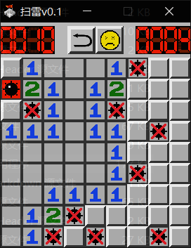

# 扫雷 · Minesweeper（SDL3）

用 **C++20 + SDL3** 从零实现的经典扫雷小游戏。固定 **11 × 15** 棋盘、**14** 颗雷，
包含剩余雷数、计时器、笑脸状态、旗子/问号标记，以及空白区域自动展开。



> 上图为早期 UI 设计稿；实际窗口为 440 × 640 像素（11 × 15 格，每格 40 px，顶部菜单 40 px）。

---

## 目录

- [特性](#特性)
- [操作方式](#操作方式)
- [项目结构](#项目结构)
- [构建与运行](#构建与运行)
- [资源说明](#资源说明)
- [实现概览](#实现概览)
- [已知限制](#已知限制)
- [许可证](#许可证)

---

## 特性

- **完整游戏流程**：`READY → RUN → WIN / LOSE` 状态机，胜负后自动停表。
- **经典规则**：左键翻格、右键在「关闭 → 旗子 → 问号 → 关闭」之间循环。
- **空白自动展开**：翻开数字为 0 的格子时，递归展开周围 8 格。
- **顶部菜单栏**：
  - 左侧四位数字显示「剩余雷数 = 总雷数 − 已插旗数」；
  - 中间笑脸按钮，点击立即重开一局，胜利/失败时切换为笑脸/哭脸；
  - 右侧四位数字秒表，从第一次点击开始计时。
- **失败复盘**：标错的旗子显示红叉，未点开的雷全部亮出，踩中的雷显示爆炸图。
- **胜利结算**：自动展示所有雷的位置。
- **调试快捷键**：按住空格可一次性展示全部格子，松开恢复。

## 操作方式

| 操作 | 效果 |
| --- | --- |
| 鼠标左键 | 翻开格子；点中雷即失败 |
| 鼠标右键 | 切换标记：关闭 → 🚩 旗子 → ❓ 问号 → 关闭 |
| 左键点击菜单中央笑脸 | 重新开始（重新布雷、清零计时） |
| 按住空格 | 调试用：显示全部格子 |
| 关闭窗口 | 退出 |

## 项目结构

```text
Minesweeper/
├── CMakeLists.txt          # 构建脚本（C++20 + SDL3 / SDL3_image / SDL3_ttf）
├── README.md
├── src/                    # 全部 C++ 源码
│   ├── Main.cpp            # 程序入口：SDL_Init + 主循环
│   ├── Application.h/.cpp  # 窗口、渲染器、事件处理与主循环
│   ├── Game.h/.cpp         # 棋盘状态、布雷、翻格、洪水展开、胜负判定
│   ├── Compose.h/.cpp      # 按棋盘状态绘制画面与顶部菜单
│   ├── Source.h/.cpp       # 图片纹理的加载与绘制
│   └── Common.h            # 常量（11×15、40 px、14 雷）与全局状态
├── assets/
│   ├── res/                # 运行时素材：格子、数字、雷、表情、计时数字等
│   ├── fonts/              # 预留字体（msyh.ttc / STXINWEI.TTF），当前未加载
│   └── windows/            # Windows 图标资源（mine.rc + mine.ico）
└── docs/
    └── design/             # v0.1 界面设计稿
```

构建结束后，`assets/res/` 会被自动复制到可执行文件同级的 `res/` 目录，
源码中的 `"res/xxx.png"` 相对路径因此保持不变。

## 构建与运行

### 环境要求

| 依赖 | 版本 / 说明 |
| --- | --- |
| CMake | ≥ 3.20 |
| 编译器 | 支持 C++20（GCC 11+ / Clang 13+ / MSVC 19.3+） |
| SDL3 | 需提供 CMake config 包（`SDL3Config.cmake`） |
| SDL3_image | 加载 PNG 素材 |
| SDL3_ttf | 已链接，当前代码尚未使用 |

SDL3 官方发布包与源码构建都会生成 CMake config，`find_package(... CONFIG)` 即可找到。
若装在自定义路径，通过 `CMAKE_PREFIX_PATH` 指定。

### Linux / macOS

```bash
cmake -S . -B build -DCMAKE_BUILD_TYPE=Release
cmake --build build -j

# 必须在可执行文件所在目录运行：程序按 res/ 相对路径加载素材
cd build && ./Minesweeper
```

### Windows

```bash
cmake -S . -B build
cmake --build build --config Release
cd build\Release && Minesweeper.exe
```

### 自定义 SDL3 安装位置

```bash
cmake -S . -B build \
  -DCMAKE_PREFIX_PATH="/opt/sdl3;/opt/sdl3_image;/opt/sdl3_ttf"
```

> ⚠️ 素材是按**当前工作目录**下的 `res/` 查找的。直接在仓库根目录执行
> `./build/Minesweeper` 会找不到图片，请先 `cd build` 再运行，或把 `res/` 复制到运行目录。

## 资源说明

| 目录 | 内容 |
| --- | --- |
| `assets/res/` | 游戏运行必需的 32 个 PNG 精灵：`blank`/`flag`/`ask` 等格子状态，`num_0`~`num_8` 数字，`mine`、`mine_blood`、`mine_wrong`、`flag_wrong` 雷与错误标记，`st_happy`/`st_neutral`/`st_sad` 三种表情，`time_0`~`time_9` 计时数字，以及 `ret`、`white` 等辅助图 |
| `assets/fonts/` | `msyh.ttc`（微软雅黑）与 `STXINWEI.TTF`（华文新魏），体积较大，仅为后续文字渲染预留，**当前运行时不会加载** |
| `assets/windows/` | `mine.rc` + `mine.ico`：旧版 Visual Studio 工程留下的窗口图标资源，CMake 未引用，可按需接入 |
| `docs/design/` | `ManuUI.png` 与 `gameUI*.png`：v0.1 界面设计稿，包含尚未实现的开始菜单与难度选择 |

## 实现概览

| 模块 | 职责 |
| --- | --- |
| `Main.cpp` | 初始化 SDL 视频子系统，构造 `Application` 并进入 `Loop()` |
| `Application` | 创建窗口/渲染器与图标，轮询事件（鼠标、键盘、退出），组织「事件 → 渲染 → 更新」主循环 |
| `Game` | 持有 `BlocksState` 二维棋盘；用 `SDL_rand` 随机布雷；`Calculate()` 计算周围雷数并递归展开空白区；`CheckWin()` 判定胜利 |
| `Compose` | 每帧把棋盘状态翻译成贴图绘制，维护雷数计数与秒表 |
| `Source` | 统一加载并缓存各类纹理（表情、数字、格子、计时），负责绘制与释放 |
| `Common.h` | 编译期常量与全局游戏状态，尺寸公式：`440 × 640 = 11×40 × (15×40 + 40)` |

## 已知限制

- 棋盘尺寸与雷数在 `Common.h` 中以宏固定，暂无难度选择。
- 首次点击没有「安全区」保护，开局第一下可能直接踩雷。
- 秒表按整秒累加，仅支持 4 位显示。
- SDL_ttf 已链接但未使用，字体素材同样未参与渲染。
- 设计稿中的开始菜单、难度选择、自定义棋盘尚未实现。
- 仓库暂未声明开源许可证。

## 许可证

当前仓库未包含 `LICENSE` 文件。如需对外分发，建议补充一份许可证（例如 MIT）；
在补充之前，请默认保留所有权利。
